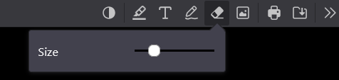
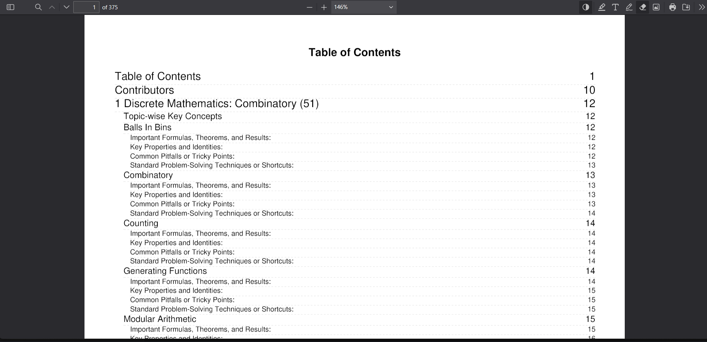
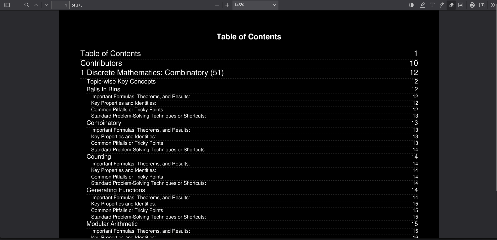

# PDF Ink Eraser

**[Get it from Firefox Add-ons](https://addons.mozilla.org/firefox/addon/pdf-ink-eraser/)** (waiting for Mozilla's
review: the link works once it's approved)

A Firefox extension that adds a real eraser to the PDF viewer. Drag over a pencil drawing, a freehand highlight or a
text highlight, and only the part under the eraser disappears, like the eraser in Paint. The built-in viewer can only
delete a whole drawing at once. It also erases marks already saved in the PDF.



One click on **Invert colours** (the half-filled circle) turns pages dark for reading at night:

| Before | After |
|---|---|
|  |  |

## Using it

1. Click the extension's toolbar button. A PDF viewer opens in a new tab.
2. Click **Open a PDF**, or drop a PDF file anywhere on the page.
3. Click the **Eraser** button next to the pencil, and drag over a mark. **Ctrl+Z** undoes a whole drag.
4. Save with the **Download** button or **Ctrl+S**. A Save as dialog lets you replace the original file.

| Key | Action |
|---|---|
| **E** | Turn the eraser on or off |
| **[** / **]** | Make the eraser smaller / bigger |

With a pen, flip it to its eraser end (or hold its eraser button) to erase.

Inverting colours only changes the display: saved and printed PDFs keep their real colours.

## Permissions and privacy

The extension collects no data and makes no network requests. The first time you save, Firefox asks for permission
to **download files**, which shows the Save as dialog. If you say no, files go to your Downloads folder instead.

## How it works

It bundles [pdf.js](https://github.com/mozilla/pdf.js), the PDF viewer inside Firefox, **unmodified** (in `vendor/`),
and adds the eraser on top. Each pointer move sweeps a circle along a line (`src/eraser.js`). Every mark it touches
is replaced by the pieces left over (`src/eraser-geometry.js`, which has unit tests). The extension's own files, such
as Save as and inverted colours, are in `extension/`.

## Building from source

Requires [Node.js](https://nodejs.org/) 20 or newer on Windows, macOS or Linux. Releases are built on Windows 11 with
Node.js 20.10.0 and npm 10.2.3. `npm ci` installs the only other tool, Mozilla's `web-ext`, at the version in
`package-lock.json`.

To build an exact copy of a release, run these in the folder with `package.json`:

```bash
npm ci
```
```bash
npm run package
```

The extension is then in `web-ext-artifacts/pdf_ink_eraser-<version>.zip` (and unpacked in `dist/extension/`).

The build script, `scripts/build.mjs`, uses only Node.js. It copies `extension/` and `src/` into `dist/extension/`,
copies pdf.js from `vendor/pdfjs-6.4.299/` without its source maps and sample PDF, and adds five `<script>` and
`<link>` tags to pdf.js's `viewer.html`. Nothing is minified, transpiled or bundled.

| Command | What it does |
|---|---|
| `npm start` | Build, then open Firefox with the extension loaded. It reloads when files change. |
| `npm test` | Run the unit tests |
| `npm run lint` | Build, then check the extension with Mozilla's add-on linter |
| `npm run package` | Build, then zip the extension into `web-ext-artifacts/` |
| `npm run sign` | Build, then have Mozilla sign it as an unlisted add-on. Needs your AMO API key in `WEB_EXT_API_KEY` and `WEB_EXT_API_SECRET` |

Browser tests are in `test-browser/harness.js`; its header explains how to run them. To update pdf.js, unpack a new
[release](https://github.com/mozilla/pdf.js/releases) into `vendor/`, change `PDFJS_VERSION` in `scripts/build.mjs`,
and run all the tests.

## Known limitations

- It doesn't replace Firefox's own PDF viewer: open PDFs from the extension's tab.
- Opening another PDF with unsaved changes offers to save them first. Cancel to discard them.
- A pdf.js 6.4 bug: a freehand highlight drawn on a rotated page moves after saving and reopening.

## License

[Apache License 2.0](LICENSE), the same as pdf.js.
