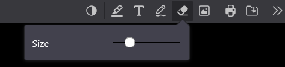
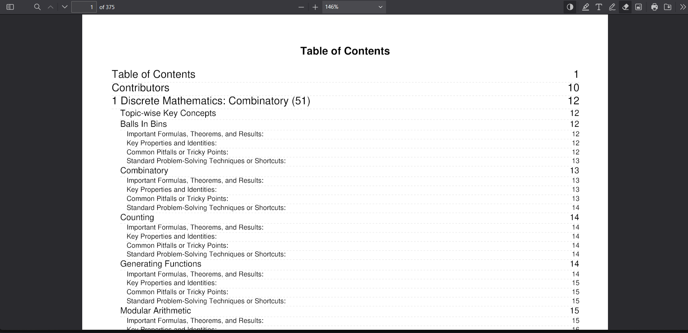
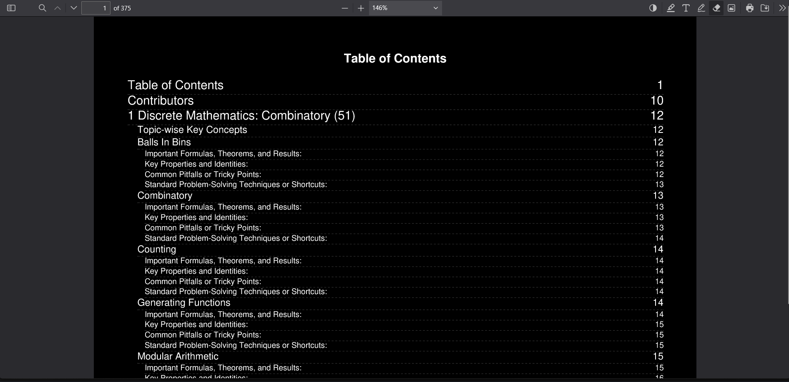

# PDF Ink Eraser

A Firefox extension for drawing and highlighting on PDFs, with a real eraser. It also opens Word and PowerPoint files.

## Install

1. Open the **[latest release](https://github.com/4kanksh/firefox-pdf-ink-eraser/releases/latest)** in Firefox and
   click the `.xpi` file under **Assets**, for example `pdf_ink_eraser-1.1.0.xpi`.
2. Firefox says it prevented the site from asking you to install software. Click **Continue to Installation**.
3. Click **Add**. That's it: the extension is installed and stays installed.

Click the PDF Ink Eraser button in the toolbar to start. If you don't see it, it's in the Extensions menu (the
puzzle piece), where you can pin it. The extension is signed by Mozilla and works in Firefox 140 or newer. For a new
version, install the newer `.xpi` from the releases page the same way.

## Word and PowerPoint files (optional helper)

Everything above works without any extra setup. **Only** to open Word and PowerPoint files (`.docx`, `.doc`,
`.pptx`, `.ppt`, and the OpenDocument `.odt`, `.odp` and `.rtf`) you also need a helper program on your computer. It
converts them to PDF, and the extension then opens the PDF like any other. LibreOffice, which does the converting,
can't run inside a Firefox extension, which is why it's a separate program.

To set it up once, on Windows:

1. Install [Node.js](https://nodejs.org/) 20 or newer.
2. Download this repository (**Code → Download ZIP**) and unzip it, or clone it.
3. In that folder, run:
   ```bash
   npm run helper:install
   ```
   It downloads LibreOffice compiled to WebAssembly (about 250 MB) and registers the helper with Firefox, for your
   Windows user only.

Then click **Open a PDF** and pick a Word or PowerPoint file, or drop one onto the page. The first time, Firefox asks
for permission to **exchange messages with programs other than Firefox**, which lets the extension start the helper.
Converting takes a few seconds: 63 slides take about 12. The files never leave your computer.
`npm run helper:uninstall` removes the helper from Firefox again.

## The eraser

The extension adds a real eraser to the PDF viewer. Drag over a pencil drawing, a freehand highlight or a
text highlight, and only the part under the eraser disappears, like the eraser in Paint. The built-in viewer can only
delete a whole drawing at once. It also erases marks already saved in the PDF.



One click on **Invert colours** (the half-filled circle) turns pages dark for reading at night:

| Before | After |
|---|---|
|  |  |

## Using it

1. Click the extension's toolbar button. A PDF viewer opens in a new tab.
2. Click **Open a PDF**, or drop a PDF file anywhere on the page. With the helper, Word and PowerPoint files work too.
3. Click the **Eraser** button next to the pencil, and drag over a mark. **Ctrl+Z** undoes a whole drag.
4. Save with the **Download** button or **Ctrl+S**. A Save as dialog lets you replace the original file.

| Key | Action |
|---|---|
| **E** | Turn the eraser on or off |
| **[** / **]** | Make the eraser smaller / bigger |

With a pen, flip it to its eraser end (or hold its eraser button) to erase.

Inverting colours only changes the display: saved and printed PDFs keep their real colours.

## Permissions and privacy

The extension collects no data and makes no network requests. The first time you save, Firefox asks for permission
to **download files**, which shows the Save as dialog. If you say no, files go to your Downloads folder instead.

The first time you open a Word or PowerPoint file, Firefox asks for permission to **exchange messages with programs
other than Firefox**. That only lets the extension start its helper, which converts the file on your computer.

## How it works

It bundles [pdf.js](https://github.com/mozilla/pdf.js), the PDF viewer inside Firefox, **unmodified** (in `vendor/`),
and adds the eraser on top. Each pointer move sweeps a circle along a line (`src/eraser.js`). Every mark it touches
is replaced by the pieces left over (`src/eraser-geometry.js`, which has unit tests). The extension's own files, such
as Save as and inverted colours, are in `extension/`.

Word and PowerPoint files go to the helper in `native-helper/` through Firefox's
[native messaging](https://developer.mozilla.org/docs/Mozilla/Add-ons/WebExtensions/Native_messaging), and the PDF
comes back the same way (`extension/office-files.js`). The helper converts with
[LibreOffice compiled to WebAssembly](https://www.npmjs.com/package/@matbee/libreoffice-converter), run by Node.js.
LibreOffice's browser version can't run in the extension page itself: it needs memory shared between threads, which
Firefox only allows on cross-origin isolated pages, and extension pages can't be.

## Building from source

Requires [Node.js](https://nodejs.org/) 20 or newer on Windows, macOS or Linux. Releases are built on Windows 11 with
Node.js 20.10.0 and npm 10.2.3. `npm ci` installs the only other tool, Mozilla's `web-ext`, at the version in
`package-lock.json`.

To build an exact copy of a release, run these in the folder with `package.json`:

```bash
npm ci
```
```bash
npm run package
```

The extension is then in `web-ext-artifacts/pdf_ink_eraser-<version>.zip` (and unpacked in `dist/extension/`).

The build script, `scripts/build.mjs`, uses only Node.js. It copies `extension/` and `src/` into `dist/extension/`,
copies pdf.js from `vendor/pdfjs-6.4.299/` without its source maps and sample PDF, and adds seven `<script>` and
`<link>` tags to pdf.js's `viewer.html`. Nothing is minified, transpiled or bundled. The helper isn't part of the
extension: it's set up separately with `npm run helper:install`.

| Command | What it does |
|---|---|
| `npm start` | Build, then open Firefox with the extension loaded. It reloads when files change. |
| `npm test` | Run the unit tests |
| `npm run lint` | Build, then check the extension with Mozilla's add-on linter |
| `npm run package` | Build, then zip the extension into `web-ext-artifacts/` |
| `npm run sign` | Build, then have Mozilla sign it as an unlisted add-on, for a GitHub release. Needs your AMO API key in `WEB_EXT_API_KEY` and `WEB_EXT_API_SECRET` |
| `npm run helper:install` | Install the Word and PowerPoint helper and register it with Firefox (Windows) |
| `npm run helper:uninstall` | Remove the helper from Firefox |

Browser tests are in `test-browser/harness.js`; its header explains how to run them. To update pdf.js, unpack a new
[release](https://github.com/mozilla/pdf.js/releases) into `vendor/`, change `PDFJS_VERSION` in `scripts/build.mjs`,
and run all the tests.

## Known limitations

- It doesn't replace Firefox's own PDF viewer: open PDFs from the extension's tab.
- Opening another PDF with unsaved changes offers to save them first. Cancel to discard them.
- A pdf.js 6.4 bug: a freehand highlight drawn on a rotated page moves after saving and reopening.
- Word and PowerPoint files: fonts are swapped for look-alikes with the same widths, and emoji show as empty boxes.
  The helper's installer only supports Windows so far.

## License

[Apache License 2.0](LICENSE), the same as pdf.js.
